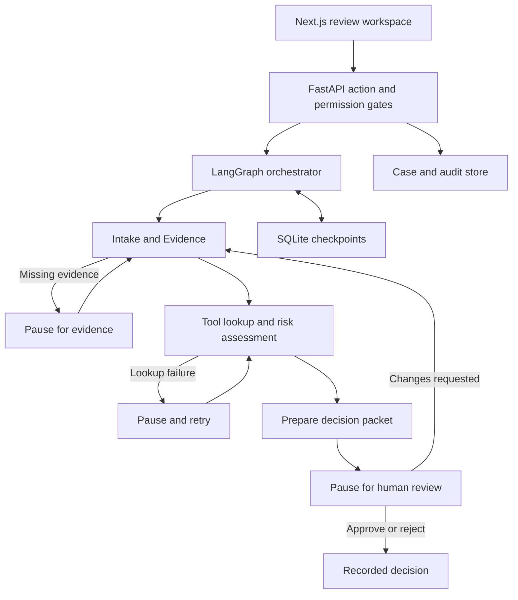

# AI Gatekeeper

A standalone healthcare AI governance demo. Assess a proposed use case, gather evidence, map risks and controls, and prepare a recorded human decision.

## Run locally

Requires Node.js 20.9+ and Python 3.12 (or `uv`).

```bash
./setup.sh
./run-local.sh
```

Open http://127.0.0.1:3100. The FastAPI service listens on http://127.0.0.1:8100; interactive API documentation is at `/docs`. Both bind to loopback. The startup script checks ports and explains missing dependencies.

The default is a **rule-based synthetic demo**, with real LangGraph execution, LangChain tools, SQLite checkpoints, evidence handoffs and enforced approval gates. No API keys are needed. It is not a validated clinical or legal compliance system.

## What works

- Six fictional healthcare use cases and new-case intake.
- Three specialist workflow roles with conditional routing.
- Required evidence checks, system-version matching and manual evidence entry.
- A clearly labeled sample-evidence action for reproducing the demo.
- Two bounded tool retries, an interruption and explicit recovery.
- Human review with evidence verification, required sign-off attestations and rationale.
- Rejection, approval and request-changes/reassessment paths.
- Backend persona gates, optimistic revisions, read-only auditor view.
- Policy citations, local event traces, audit history and JSON decision-packet exports.
- Responsive Next.js interface with subdued blue and light purple monitoring.

## Optional live specialist agents

Copy `.env.example` to `.env`. Set `GATEKEEPER_MODE=live`, configure `OPENAI_API_KEY`, and set `OPENAI_MODEL` to a model available to your account. Restart the backend.

In live mode the Intake and Evidence, Risk and Controls, and Review Preparation specialists use LangChain `create_agent` with bounded read-only tool calls. The model chooses relevant tools and supplies advisory analysis. Code retains authority over required evidence, risk classification, approval gates and state transitions. Model failures fall back to the deterministic workflow and appear in the trace. The live provider path has not been verified without credentials.

Set `LANGSMITH_TRACING=true`, `LANGSMITH_API_KEY` and `LANGSMITH_PROJECT` to trace runs to your project. Tracing is off by default. Only use synthetic data in this demo.

## Demo journeys

1. **GK-001 Staff policy knowledge assistant:** Run, inspect findings and tool calls, switch to Governance Reviewer, verify evidence and sign-offs, enter a rationale, approve.
2. **GK-002 Patient message drafting:** Run to pause for missing BAA, evaluation and monitoring evidence. Add demo evidence, resume and inspect the high-risk review route.
3. **GK-005 Discharge instruction drafting:** Run to see two failed register attempts. Retry and inspect the resumed assessment and preserved events.
4. **GK-003 Clinical notes:** Resolve missing vendor reconciliation evidence and demonstrate request changes followed by reassessment.
5. **GK-004 Research cohort:** Demonstrate missing or wrong-version de-identification evidence.
6. **GK-006 Autonomous prescribing:** Add required demo evidence and run/resume. Approval remains blocked by policy; a reviewer can reject.

## Architecture



Source policy retrieval is exact identifier lookup over a versioned synthetic catalog. This is not an embeddings or vector-retrieval application. SQLite is intentional for a portable local demo; no PostgreSQL service is required.

## Validation

```bash
.venv/bin/python -m pytest -q tests
npm --prefix frontend run build
```

Tests cover the happy path, missing evidence, wrong versions, conflict review, request changes, durable checkpoint recovery, failed tool attempts, approval blockers, persona restrictions, stale revisions, citations and exports. `tests/results.xml` is the most recent machine-readable test result.

## Project structure

- `frontend/`: Next.js App Router UI and API proxy.
- `backend/main.py`: validated HTTP actions, case/audit storage and decision gates.
- `backend/workflow.py`: LangGraph graph, specialist roles, tools and optional live agents.
- `backend/seed.py`, `data/catalog.json`: fictional cases, policies, tools and controls.
- `tests/`: isolated workflow and API tests.
- `docs/`: solution architecture and walkthrough deliverables.
- `runtime/`: local case/checkpoint databases, intentionally excluded from Git.

## Boundaries before deployment

Persona selection is a local demonstration mechanism, not authentication. Specialist sign-offs are reviewer attestations, not independently authenticated approvals. Audit rows are append-only through the app, not tamper-proof. Evidence metadata and version checks do not establish substantive truth or HIPAA compliance. Risk gates depend on structured intake declarations; this demo does not independently classify clinical intent from arbitrary prose. Add SSO, server-bound roles, individual sign-offs, access controls, encrypted managed storage, hardened uploads, secrets management and operational review before exposing this service. No deployment is included in this local validation milestone.

## Sources

The scope follows the Week 3 Project Handout (October 2026): stateful tool use, failure recovery, human handoff, project documentation and a demo of five minutes or less. The source handout is not redistributed here.

Public healthcare background links are listed in `data/catalog.json`. Internal policies and vendor names are fictional. This project does not certify regulatory compliance.
